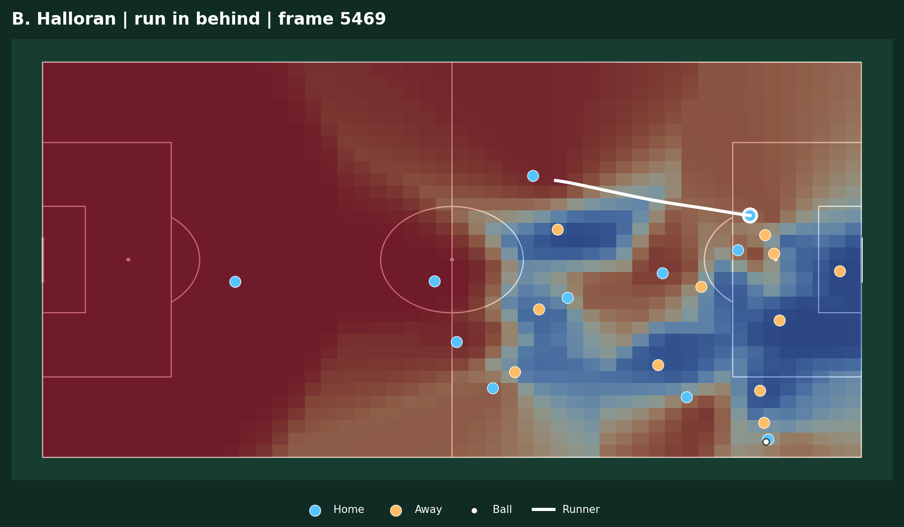

# Off-Ball Run & Space Creation Valuation Engine

A reproducible football-tracking portfolio project that turns public broadcast XY data into **reviewable off-ball run candidates** and a spatial-opportunity signal. It combines gap-aware player kinematics, a velocity-aware pitch-control approximation and a published expected-threat (xT) surface. The notebook walks through a real A-League match and produces a freeze frame and an animation.



[View the animated sequence](figures/run_clip.gif) · [Open the match walkthrough](notebooks/01_match_walkthrough.ipynb)

**Interpretation:** the score is the *observed change in team-wide xT-weighted control* while the run occurs. It is not standard on-ball action xT, expected goals, or causal credit to the runner. Multiple simultaneous runs can share the same change; do not add their scores as independent player contributions. This is a coaching-review shortlist, not a validated player rating.

## Quick start

Use Python 3.11 or 3.12; the pinned environment was tested with 3.12. Newer Python versions may require updated dependency pins. From the repository root:

```bash
python3.12 -m venv .venv       # or python3.11
source .venv/bin/activate      # Windows: .venv\Scripts\activate
python -m pip install -r requirements.txt
python -m pytest -q
jupyter notebook notebooks/01_match_walkthrough.ipynb
```

The first notebook run downloads match `1874553` from the [official SkillCorner Open Data repository](https://github.com/SkillCorner/opendata). The JSONL is approximately 91 MB; on first valuation, the xT grid is also downloaded from its author and cached locally; selecting a frame window limits parsing, **not** download size. Data are cached in `data/<match_id>/` and ignored by Git. Internet access is needed for the first run; reruns use the cache. Git LFS is not needed: the loader fetches its media endpoint. You can use other IDs available upstream, or pass local JSON and JSONL paths to `load_local_match`.

The notebook runs frames 5000–5999 (a 100-second window) of Brisbane Roar FC vs Adelaide United, 23 November 2024; it is not a full-match or league-wide comparison. It uses a permissive 20% direct-detection minimum per team at both endpoints to yield a case study, so many positions may be extrapolated. The API default is 50%. In the executed example, 69 speed bouts yielded six eligible valued bouts. The top-ranked candidate, B. Halloran, lasted 4.6 s; team control increased by 1,145.9 m² during that interval. This observed team-level change is not an estimate of his individual causal effect. Notebook outputs were generated from the public match; figures can be regenerated by running all cells.

## What the engine does

1. **Load:** parse 10 Hz SkillCorner JSONL into one observation per player and frame, in metres with the origin at pitch centre. Map players and team possession from match metadata. Retain `is_detected` and missing values; `False` means the provider extrapolated a position.
2. **Kinematics:** fill bounded gaps of at most five consecutive frames, never long or unbounded gaps. Smooth each continuous trajectory with a seven-sample Savitzky–Golay filter and compute velocity and acceleration using timestamps. Segment bouts with speed ≥ 4 m/s for ≥ 0.7 s; one finite sub-threshold frame may be bridged. Sprint is a peak of ≥ 7 m/s. Thresholds are demonstrative, not ground-truth labels.
3. **Filter and classify:** require continuous known possession by the runner's team, a known carrier who is not the runner throughout, and sufficient player coverage at both endpoints. Classify geometric candidates as runs in behind, overlaps, defender-follow candidates, other forward or supporting runs. The back-line rule uses the second-deepest defender as a goalkeeper proxy; overlaps use ball-relative geometry; defender-follow means a nearby defender moved and remained nearby. None identifies intent or proves a defender was dragged away.
4. **Score:** use 50 × 32 pitch cells. Each player coasts for 0.7 s using clipped current velocity, then covers remaining distance at 5 m/s. At each cell, compare the fastest team arrival times with `sigmoid((T_def - T_att) / 0.45)`. This is a relative, uncalibrated control score inspired by time-to-intercept modelling, **not** a full [Spearman pitch-control model](https://static.hudl.com/craft/downloads/SSAC2018_Beyond_Expected_Goals.pdf?mtime=20180327111214). It omits ball flight, pass feasibility, facing, acceleration and reaction heterogeneity.
5. **Value:** sample [Karun Singh's 12 × 8 open xT grid](https://karun.in/blog/data/open_xt_12x8_v1.json), oriented to the attacking goal. For cell area `A`, define `C = Σ controlᵢ A` (m²) and `W = Σ controlᵢ × xTᵢ × A` (xT·m²). Report `space_created_m2 = C_end − C_start`, `xt_weighted_space_added_m2 = W_end − W_start`, and `xt_added_proxy = (W_end − W_start) / pitch_area`. Values can be negative. The normalized proxy is an index, **not** the xT gained by an actual ball action or a goal probability.

The xT surface is a pre-trained positional model, not fitted to this match or league. The attack direction comes from `home_team_side` per half; the API requires an explicit `(period, 'home'/'away') -> ±1` map and fails if a needed direction is missing.

## Example API

```python
from src.data_loader import load_match
from src.kinematics import add_kinematics
from src.run_detector import detect_and_value_runs

raw, meta = load_match(1874553, cache_dir="data", start_frame=5000, end_frame=5999)
tracking = add_kinematics(raw)
directions = {(1, "home"): 1, (1, "away"): -1}  # check match metadata
runs = detect_and_value_runs(
    tracking, directions, pitch_length=meta["pitch_length"],
    pitch_width=meta["pitch_width"], min_detected_fraction=0.2,
)
print(runs.sort_values("xt_added_proxy", ascending=False).head())
```

For full matches, consider processing contiguous windows: smoothing and bout segmentation at window boundaries may differ from processing the full half, and 10 Hz long-form tracking can consume significant memory. `kloppy` is pinned for interoperability experiments; the current loader deliberately uses the provider's JSONL directly so detection and possession flags remain explicit.

## Evaluation and limitations

This repository includes unit tests for interpolation, derivative calculations, segment boundaries, control symmetry and direction, loader parsing, eligibility and classifications. These tests check software behaviour, not tactical accuracy. The model has not been calibrated to passes or evaluated against video-labelled run types. Broadcast occlusion, provider extrapolation, identity errors, missing possession labels and tracking discontinuities can affect speed, run counts and control. Strict known-carrier filtering sacrifices recall; absent labels are never treated as evidence that a player is off-ball. No coverage filter can make extrapolated positions ground truth.

For a research-grade extension, annotate a stratified sample on video and report precision/recall and inter-annotator agreement; compare multiple coverage, speed and smoothing settings; measure false positives separately by run type; and validate control against pass outcomes and xT on held-out matches. To estimate run-specific impact, evaluate a defensible matched counterfactual or a learned defender-response model rather than attributing endpoint changes to one player.

## Repository map

```text
src/data_loader.py       Official download, cache and JSONL parser
src/kinematics.py        Interpolation, smoothing, derivatives and segmentation
src/spatial_model.py     Time-to-intercept control and xT integration
src/run_detector.py      Eligibility, heuristic labels and endpoint valuation
src/visualize.py         mplsoccer freeze frame and animated GIF
notebooks/               Executed, narrative single-match walkthrough
tests/                   Synthetic unit and model-property tests
figures/                 Reproducible example visual outputs
```

## Attribution and license

Code is licensed under the [MIT License](LICENSE). Tracking data is from [SkillCorner Open Data](https://github.com/SkillCorner/opendata), released by SkillCorner with PySport; please credit SkillCorner and consult the [upstream license](https://github.com/SkillCorner/opendata/blob/master/LICENSE). Match data are downloaded separately and not bundled here. The xT grid is downloaded on demand from [Karun Singh's public grid](https://karun.in/blog/data/open_xt_12x8_v1.json) and is not bundled; see [Introducing Expected Threat](https://karun.in/blog/expected-threat.html). Its source does not state a separate reuse license, so check its terms with the author before redistributing it or using it commercially. The project code's MIT license does not grant rights to this third-party grid.
